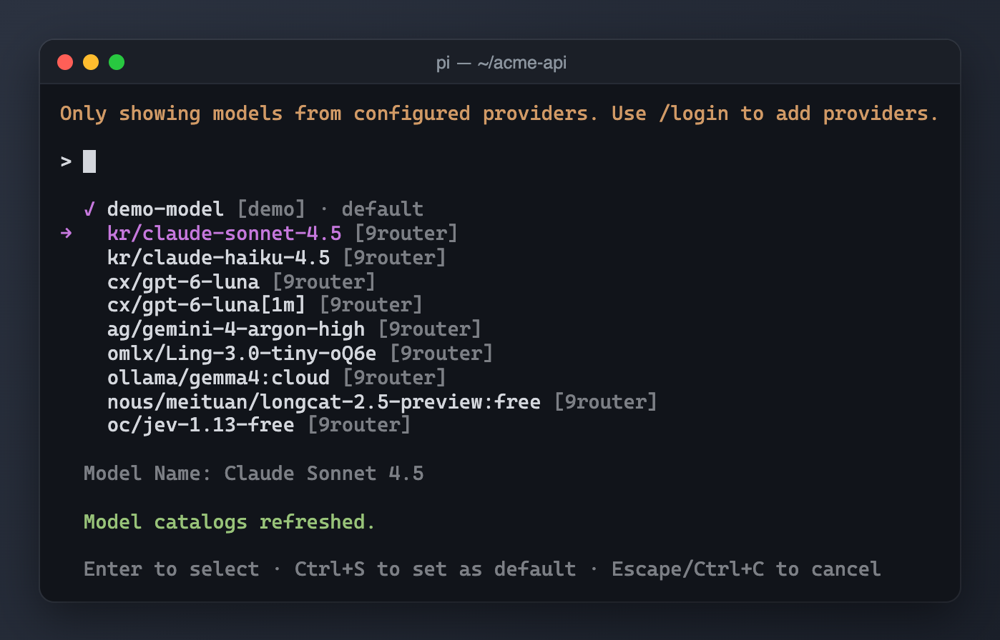

# pi-9router



*9Router model provider driven by the router's own `/v1/models` endpoint, plus `fetch`, `search`, and `transcribe` tools.*

Model discovery uses only the router's models API: every model the router lists is registered from the capabilities it advertises itself (`vision`, `reasoning`, `thinkingFormat`, `contextWindow`, `maxOutput`) — no external catalogs (modelgrep, models.dev, opencode zen) are consulted, so a third-party outage can never break model discovery.

Based on [@xynogen/pix-9router](https://www.npmjs.com/package/@xynogen/pix-9router) via the [@haoyiyin/9router](https://www.npmjs.com/package/@haoyiyin/9router) fork (both MIT); see [NOTICE.md](./NOTICE.md).

## Install

```
pi install npm:@saifymatteo/pi-9router
```

## Configure

There is no built-in default endpoint. Run `/login`, select **9Router**, and enter the base URL and API key.

The two halves live in different files, both under `<agent-dir>` (`PI_CODING_AGENT_DIR` or `~/.pi/agent`):

- `extensions/9router.json` — the base URL and options (mode `0600`); **no API key is stored here**. This is the same directory other packages use for their settings (typically a symlink into your dotfiles), so it can be versioned safely.
- `auth.json` — the API key, stored by pi as the standard `9router` login credential; chat authentication reads it from there, and so do the bundled tools.

`ROUTER_API_BASE` / `ROUTER_API_KEY` environment variables override the config file and the credential respectively.

Migrating from `@haoyiyin/9router`: on first launch the extension reads the old `haoyiyin/9router.json` (or the intermediate `saifymatteo/9router.json` from 0.1.0 dev builds), writes the new secret-free config, and moves the key into the `auth.json` credential. The old file is left in place because published pi-vision releases still read it; delete it once your pi-vision version resolves the new location.

## Model discovery

The provider refreshes `<router-base-url>/models` every 30 minutes (cached at `~/.cache/pi/9router.json`) and maps each model to pi's registry from the router's own capabilities:

| Router capability | Registered as |
| --- | --- |
| `capabilities.vision` | model `input` (`["text", "image"]` or `["text"]`) |
| `capabilities.reasoning` | `reasoning` |
| `capabilities.thinkingFormat` / `thinkingCanDisable` | `compat.thinkingFormat` + `thinkingLevelMap` |
| `capabilities.contextWindow` (or `context_window` / `context_length`) | `contextWindow` |
| `capabilities.maxOutput` (or `max_tokens` / `max_completion_tokens`) | `maxTokens` |

Cost is registered as zero for every model (the router meters usage). Display names are derived from the model id (e.g. `kr/claude-sonnet-4.5` → *Claude Sonnet 4.5*) since the router does not advertise names. A failed refresh falls back to the stale cache; an unavailable router registers no models until it answers again.

Combo models (`owned_by: "combo"`) advertise no capabilities, so their reasoning is decided by `comboReasoning` in the config file. It defaults to **on** (assumes combo routes hit thinking-capable upstreams) with the full `off..max` range. Opt out per machine with:

```json
{
  "comboReasoning": false
}
```

To override that default range, pass a custom `thinkingLevelMap` (keys: `off`, `minimal`, `low`, `medium`, `high`, `xhigh`, `max`; values: what gets sent to the router, `null` hides the level). For example, to cap combo models at `high`:

```json
{
  "comboReasoning": { "thinkingLevelMap": { "xhigh": null, "max": null } }
}
```

## Tools

`fetch` / `search` / `transcribe` behave the same as in `pix-9router`; collapse config still lives in `~/.pi/agent/pix.json`. They register only when a base URL and a credential are both available at load time (logging in mid-session enables them on the next launch). Disable any of them individually via the `tools` section of the config file — every tool is on by default:

```json
{
  "tools": { "transcribe": false }
}
```

## License

AGPL-3.0-only — see [LICENSE](./LICENSE). The vendored `fetch`/`search`/`transcribe`/`http`/`render` sources remain MIT (see [NOTICE.md](./NOTICE.md)).
