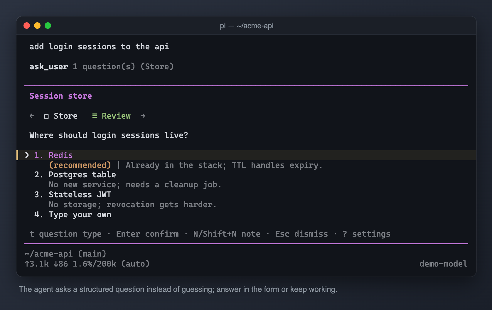

# pi-agent-ask



A trimmed fork of the Pi ask extension, published as `@saifymatteo/pi-agent-ask`. An agent asks you a structured question and keeps working while you answer; `wait_for_answers` is the explicit blocking gate.

## Upstream

The original features and their full documentation live upstream:

- [alexshpunt/pi-agent-ask](https://github.com/alexshpunt/pi-agent-ask) — the direct upstream this repo forks ([original README](https://github.com/alexshpunt/pi-agent-ask#readme))
- [eko24ive/pi-ask](https://github.com/eko24ive/pi-ask) — the original project that upstream builds on ([original README](https://github.com/eko24ive/pi-ask#readme))
- [maudelv/pi-ask, branch `feat/herdr-blocked-state`](https://github.com/maudelv/pi-ask/tree/feat/herdr-blocked-state) — source of the Herdr blocked-state support

## Install

```bash
pi install npm:@saifymatteo/pi-agent-ask
```

Remove any other `pi-ask` installation so only one extension provides `ask_user`, then reload Pi.

## Our changes

Differences from upstream:

- trimmed the agent-facing surface to two tools, `ask_user` and `wait_for_answers`, with compact descriptions to cut agent context
- removed the agent-facing history tools, the bundled skill, the config system-prompt line, and external UI negotiation
- kept the interactive form UI, background question queue, journal-based form recovery, and Herdr blocked state
- integrated clipboard providers: compatible clipboard extensions can serve image pastes in answers and notes, with built-in clipboard reading as fallback
- guided agents to use `previewFile` for long previews already on disk instead of copying the text into tool calls

Fork-specific docs: [configuration](docs/configuration.md) (config JSON schema: `"$schema": "https://raw.githubusercontent.com/saifymatteo/pi-extensions/main/packages/pi-agent-ask/schemas/pi-agent-ask.schema.json"`), [tool contract](docs/contract.md), [integration events](docs/remote-events.md).

## Long previews

Long file proposals stay inside Ask's styled preview pane. Use **PageUp/PageDown** to page through the text or **Home/End** to jump to its beginning/end; an overflowing pane shows the visible row range. Options and footer controls stay outside the paged content. These keys continue to control text editing while an answer or note editor is open.

In **fullscreen mode**, hover over the preview and use the mouse wheel to scroll its text. Hover over the transcript to scroll that instead. Scrolling stops at the preview's ends without spilling into the transcript or changing keyboard focus. In regular mode, the terminal owns mouse scrolling; use the keyboard to page the preview.

## License

AGPL-3.0-only for changes from 1.2.2 onward ([LICENSE](LICENSE)); upstream portions remain MIT ([LICENSE.MIT](LICENSE.MIT)). See [NOTICE.md](NOTICE.md).
