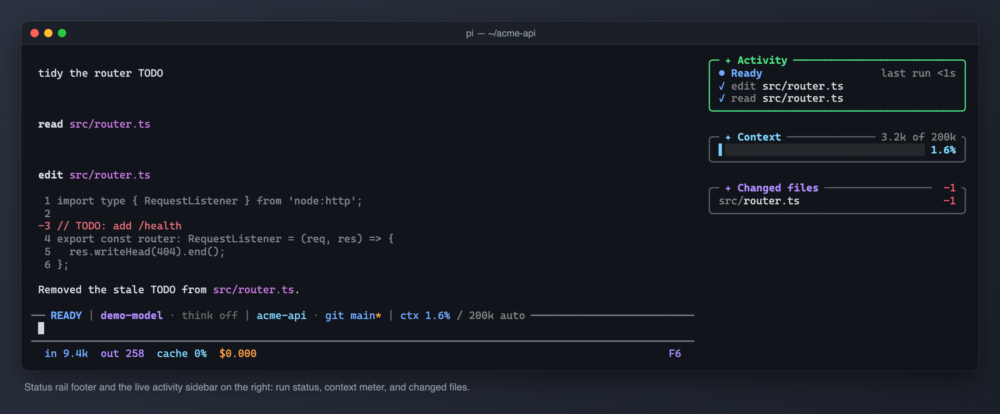

# pi-atelier



A fork of [michaelmjhhhh/pi-atelier](https://github.com/michaelmjhhhh/pi-atelier) — a responsive status rail and live activity sidebar for [Pi](https://pi.dev).

**The original work and its full documentation live upstream.** Read the [upstream README](https://github.com/michaelmjhhhh/pi-atelier#readme) for what Pi Atelier is, how to install and use it, and its complete feature, configuration, and troubleshooting reference. This README covers only what this fork adds or changes on top of upstream v0.20.0 plus the framed panel title-casing fix (`a799be1`). [`CHANGELOG.md`](CHANGELOG.md) records every fork release.

## Install

```bash
pi install npm:@saifymatteo/pi-atelier
```

Published to npm as [`@saifymatteo/pi-atelier`](https://www.npmjs.com/package/@saifymatteo/pi-atelier), and bundled in the [`@saifymatteo/pi-extensions`](https://github.com/saifymatteo/pi-extensions) collection; install one or the other. Releases publish from [pi-extensions](https://github.com/saifymatteo/pi-extensions) with `pi-atelier-v<version>` tags through npm Trusted Publishing.

## Changes in this fork

### Extension statuses on dedicated rows

Upstream renders custom-extension statuses inline in the Status Rail and drops or compacts the rail when they grow. This fork renders them on dedicated rows beneath the rail: statuses wrap as whole items onto further rows, adjacent statuses in a row are separated by the rail's dim separator, and an over-wide status truncates with an ellipsis instead of forcing the rail to compact. Applies to both footer modes.

### Automatic extension status colors

Extension statuses cycle through pink, green, gold, orange, purple, and cyan in display order, repeating after six statuses. Colors follow the configured status order, continue across wrapped rows, and can shift when a status is added or removed. Separators stay dim; `NO_COLOR` disables these status colors.

### Configurable extension status ordering

`extensionStatusOrder` orders individual custom-extension statuses by their exact `setStatus()` keys. Listed statuses come first; unlisted statuses keep Pi's order. Trusted project configuration can override the user list.

```json
{
  "extensionStatusOrder": ["my-extension:sync", "other-extension:build"]
}
```

### Copy-friendly editor

The composer uses the full available width with fixed one-column horizontal padding and no vertical side rails, keeping the session status header, native horizontal rules, scroll hints, and autocomplete placement. The bundled standalone `copy-friendly-editor.ts` extension is disabled so a single editor owns the composer.

### Footer and editor coexistence

While the copy-friendly editor's status header is visible, Atelier shows the telemetry-only footer instead of repeating session information. Extension statuses keep their dedicated rows in both footer modes and are not repeated in the header; the complete footer remains the fallback when the header cannot display them.

### Packaging and fixes

- The npm package is scoped to `@saifymatteo`, and package metadata points at this fork's repository and homepage.
- Tool paths resolve with the path flavor of their inputs, so activity and display paths stay correct when Windows and POSIX forms are mixed.
- Telemetry rows that render to invisible content are no longer dropped.

## Development

From the pi-extensions root: `npm ci`, then `npm run typecheck` and `npm test -w packages/pi-atelier`. Try it with `pi -e ./packages/pi-atelier`.

Upstream is no longer merged automatically; port upstream fixes by hand.

## License

AGPL-3.0-only for changes from 0.20.3 onward ([LICENSE](LICENSE)); upstream portions remain MIT ([LICENSE.MIT](LICENSE.MIT)). See [NOTICE.md](NOTICE.md).
