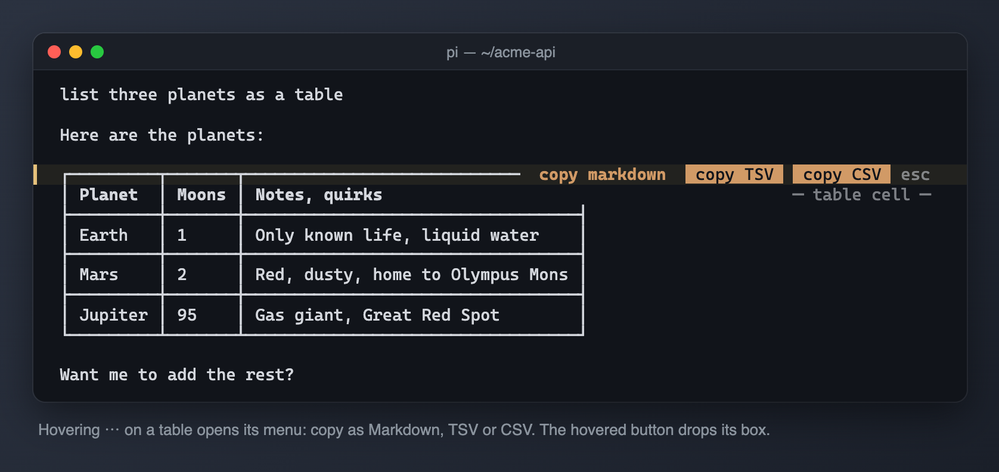

# pi-cell-actions



*Hovering `⋯` on a table opens its menu: copy as Markdown, TSV or CSV.*

Hover any cell of the transcript for a yellow `⋯` badge at its top-right. Messages split into cells by block: each paragraph, list, quote, heading, code block and table is its own cell, and each tool call is one. Hover the badge to open that cell's actions; `esc` (clicked or the Esc key) or moving to another cell closes the menu.

| Cell | Actions |
| --- | --- |
| Paragraph, list, quote or heading | copy (its Markdown source) |
| Code block | copy (code only, no fences or line numbers); `bash`/`sh`/`shell`/`zsh` blocks also **run** |
| Table | copy markdown, copy TSV, copy CSV |
| Tool call | copy input (JSON arguments), copy output (text result). On a pi-compact-tools card, the header copies the whole group; an expanded call copies itself, with **all input** / **all output** for the group |

The clicked button shows `✓ copied` for 1.5 s. Pi's built-in `/copy` still copies the last reply from the keyboard.

## Running locally

From the monorepo root:

```sh
pi -e ./packages/pi-cell-actions
```

**Warning:** this extension uses your existing Pi resources and settings unless you load it in an isolated home (see the root README). Do not load two copies of the same extension (for example an older standalone file alongside this package): commands and hooks can duplicate. The package never installs or relocates personal settings.

## Requirements

- Fullscreen TUI (`"tuiMode": "fullscreen"`, Pi's default). In regular mode the terminal owns the mouse, so no badge appears.
- Hover needs all-motion mouse reporting. Pi turns it off inside tmux, screen and Zellij; there the badge appears on mouse press instead of hover.

## Run

**run** asks for confirmation with the full block, then runs it with that shell in Pi's working directory (2-minute timeout). The command, exit status and output appear as a `cell-run` message below the transcript; it is added to the model's context on its next turn and does not start a turn by itself.

## Settings and storage

None. The package keeps no configuration file and writes nothing except clipboard text and `cell-run` messages.

## Compatibility

Works on stock Pi 1.4+ and Pi-Bolt. It draws the badge and menu in one non-capturing overlay instead of patching renderers, kept inside the scrolling transcript so it never covers the editor, and reads hover positions by observing (never handling) mouse events on Pi's user, assistant and tool components. Code blocks and tables are located by content in the rendered rows, so pi-codeblock-borders, shaded code blocks and Pi-Bolt's renderer all work. If a host update removes these components or the fullscreen mouse API, the badge stops appearing; Pi keeps working.

See [NOTICE.md](NOTICE.md) for provenance. Tests run the pure parsing helpers and a stubbed host; they do not contact services or write to user-home resources.
