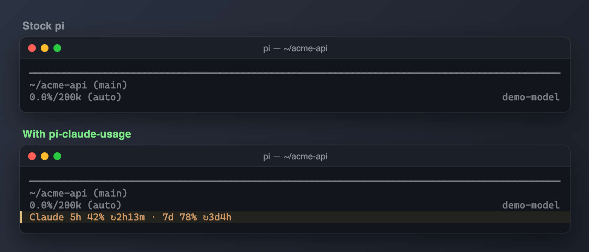

# Claude subscription usage



*An extra footer line shows Claude 5-hour and 7-day usage and when each window resets. Its colour changes at 75% and 90%.*

Displays Claude subscription rate-limit windows from provider message diagnostics.

## Try locally

From the repository root:

```sh
pi -e ./packages/pi-claude-usage
```

This uses your normal personal resources unless you isolate the agent home. Follow the [root README](../../README.md#isolated-sessions) to avoid loading an existing copy of the extension. Nothing is installed globally. 

## Configuration and requirements

Uses rate-limit diagnostics from the external pi-claude-code provider; it does not poll Anthropic. Caches the most recent windows in <agent-dir>/state/claude-usage.json. The footer is shown only while the selected model uses the `claude-code` provider, not for Claude models accessed through other providers. Switching providers hides or restores it immediately. No additional configuration.

## Compatibility and safety

Status/footer presentation depends on the host and other footer extensions.

Imported host APIs are declared as peer dependencies and supplied by the Pi host. A `*` peer range describes host resolution, not a guarantee of compatibility with every release. See root verification notes for what was actually exercised.

## Status

Part of the [pi-extensions](../../README.md) collection. No personal settings or credentials are included; see [NOTICE.md](NOTICE.md) for licensing and provenance.
