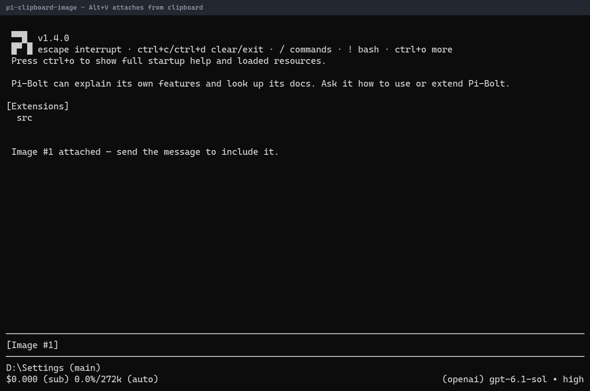

# Clipboard image attachment



Attaches clipboard images to the draft, including copied image files on Windows.

## Try locally

From the repository root:

```sh
pi -e ./packages/pi-clipboard-image
```

This uses your normal personal resources unless you isolate the agent home. Follow the [root README](../../README.md#isolated-sessions) to avoid loading an existing copy of the extension. Nothing is installed globally. 

## Configuration and requirements

Registers Alt+V and Ctrl+Alt+V. Uses OS clipboard tools/native clipboard support and temporary image files. Windows/WSL use PowerShell; macOS and Linux use platform-specific clipboard mechanisms. See source for fallbacks; platform behavior needs manual verification.

## Compatibility and safety

Reads clipboard image/file data and places it in the draft. Sending the draft transmits attachments to the selected model. Requires interactive terminal support; terminal shortcuts may intercept the key.

Imported host APIs are declared as peer dependencies and supplied by the Pi host. A `*` peer range describes host resolution, not a guarantee of compatibility with every release. See root verification notes for what was actually exercised.

## Status

Part of the [pi-extensions](../../README.md) collection. No personal settings or credentials are included; see [NOTICE.md](NOTICE.md) for licensing and provenance.
