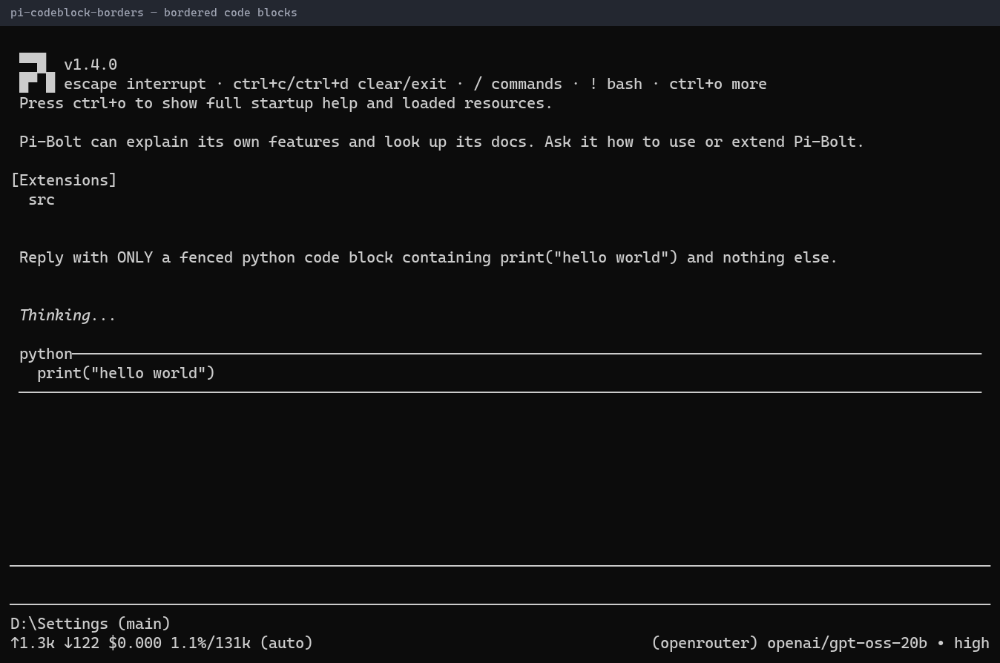

# pi-codeblock-borders



Render markdown code fences as full-width rules spanning the content area, and upgrade the fence info string with language decoration, titles, and line numbers that Pi's built-in renderer does not support.

## Running locally

From the monorepo root:

```sh
pi -e ./packages/pi-codeblock-borders
```

**Warning:** this extension uses your existing Pi resources and settings unless you load it in an isolated home (see the root README). Do not load two copies of the same extension (for example an older standalone file alongside this package): commands and hooks can duplicate. The package never installs or relocates personal settings.

## Behavior

- Replaces the literal ``` fence markers with horizontal rules sized to the terminal width.
- Decorates the opening info string: `lang`, `lang` separators, optional `title`, and `:line-numbers`.
- Patches the theme's `codeBlockBorder`/`highlightCode` callbacks for the session and restores the originals on `session_shutdown`.
- Applies to every markdown code block; there is no per-block opt-out.

## Settings and storage

None. The extension holds no configuration file and reads no user data beyond the rendered token stream.

## Compatibility

Node.js >=24 for development checks; run extensions through Pi's TypeScript loader. Host imports are wildcard peers, not bundled runtime copies. The patch reaches into Pi-TUI `Markdown` internals, so host-version changes can break it; verify against your target host before relying on it. Overlapping UI patches (for example from pi-atelier) need integration testing; load one renderer patch at a time in an isolated session first.

See [NOTICE.md](NOTICE.md) for provenance. Tests patch a stubbed renderer and never contact services or write to user-home resources.
