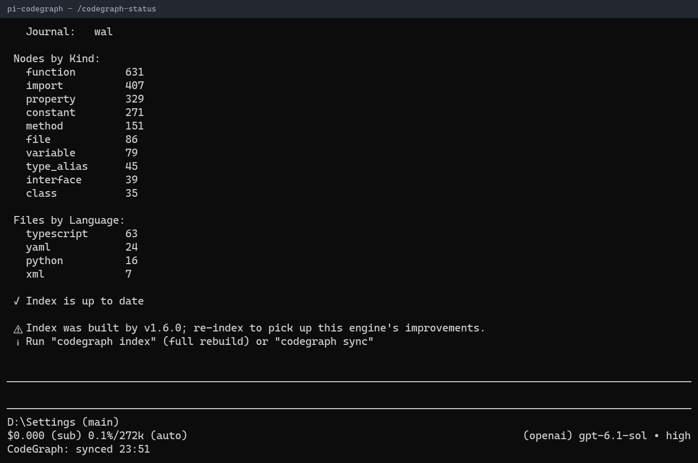

# @saifymatteo/pi-codegraph



## Purpose and registrations

Registers `codegraph_explore`, `/codegraph-init`, `/codegraph-sync`, `/codegraph-status`, `/codegraph-unlock`, session startup/shutdown and settle-sync hooks, and footer status.

## Configuration and external CLI

Requires `codegraph` on PATH (external package `@colbymchenry/codegraph`; not installed here). Windows invokes its cmd shim. Reads `<agent-dir>/extensions/codegraph.json`, then index-owner `.pi/codegraph.json`. Boolean keys: `autoInit`, `syncOnSettle`. Missing config is auto-created with both **true**, preserving source behavior. The manually authored example sets both false for cautious testing. Existing indexed roots still receive startup sync in UI modes even when both flags are false.

## Host limitations and security

Requires host execution, status and lifecycle APIs. Background indexing runs only with `ctx.hasUI` (TUI/RPC); manual commands still work in print/JSON. Walks parents for `.codegraph/codegraph.db`. The CLI reads source and writes its index; consult its own configuration for model/network behavior. Query results become model-visible. Startup can create agent config and indexes; use an isolated agent directory and disposable workspace. Do not load alongside upstream `@izhimu/pi-codegraph` or another copy of this adapter. Upstream attribution is retained, but the merged package is not claimed to be MIT; see NOTICE.

## Tests

From the monorepo root with its existing test dependencies available:

```sh
node --test packages/pi-codegraph/test/*.test.mjs
```

Tests use the shared test-only TypeScript/VM loader, fixtures, and host/service stubs. They do not prove compatibility with a live host, CLI, or model service.

## Running locally

From the monorepo root:

```sh
pi -e ./packages/pi-codegraph
```

Node >=24; host imports are peers, not bundled dependencies. Load only one copy: for an isolated session use `--no-extensions` with explicit `-e` paths so the original live extension is not also discovered. Set `PI_CODING_AGENT_DIR` to a disposable agent directory before launch; unset means the normal `~/.pi/agent` fallback. Extension config continues to resolve there, never relative to this package.

Examples are manually authored, sanitized reference documents, not runtime defaults. Review and manually create only the needed files in the isolated agent directory; do not copy live credentials or endpoints. No example is automatically loaded or copied. Loading an extension grants Pi-process OS permissions. Licensed AGPL-3.0-only; see [NOTICE.md](NOTICE.md).
