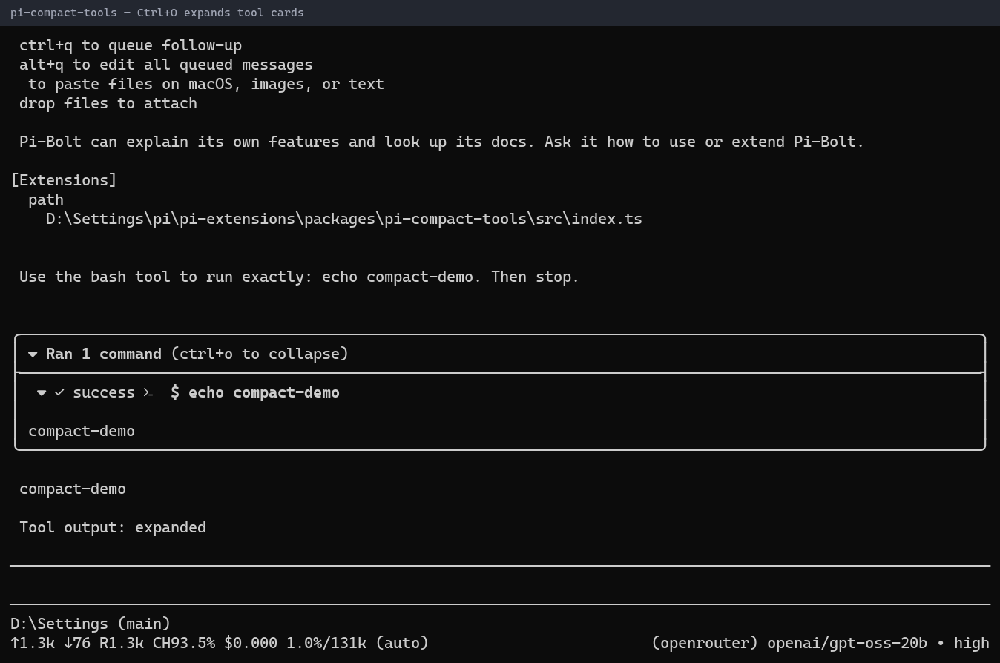

# Compact tool cards



Groups consecutive tool calls into compact expandable transcript cards.

## Try locally

From the repository root:

```sh
pi -e ./packages/pi-compact-tools
```

This uses your normal personal resources unless you isolate the agent home. Follow the [root README](../../README.md#isolated-sessions) to avoid loading an existing copy of the extension. Nothing is installed globally. 

## Configuration and requirements

No package configuration. Ctrl+O toggles expansion; child rows retain individual disclosure controls. Changes rendering, not tool execution.

## Compatibility and safety

Uses public tool-renderer registration plus private assistant/tool component prototype and layout patches. Test visually on your exact Pi release. Do not stack competing transcript-renderer patches without testing.

Imported host APIs are declared as peer dependencies and supplied by the Pi host. A `*` peer range describes host resolution, not a guarantee of compatibility with every release. See root verification notes for what was actually exercised.

## Status

Part of the [pi-extensions](../../README.md) collection. No personal settings or credentials are included; see [NOTICE.md](NOTICE.md) for licensing and provenance.
