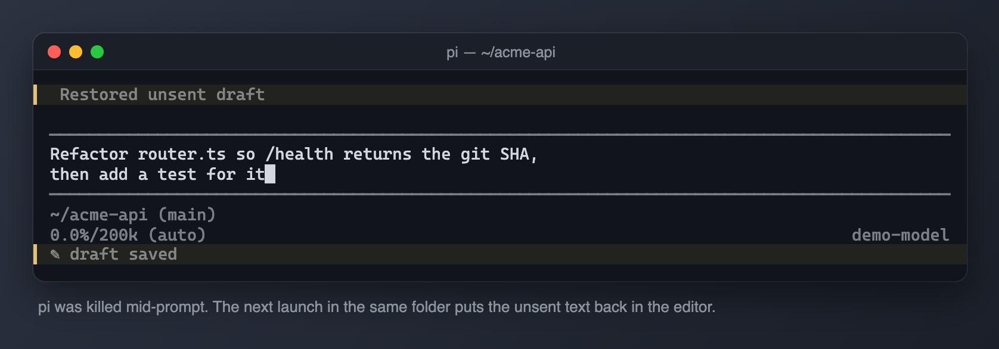

# pi-draft



*pi was killed mid-prompt. The next launch in the same folder puts the unsent text back in the editor.*

Autosave the prompt you are typing, like an unsaved editor tab. Quit Pi, close the terminal, or lose the process to a crash, and the next Pi launch in the same folder restores the text. Sending the prompt or clearing the editor discards the draft.

## Running locally

From the monorepo root:

```sh
pi -e ./packages/pi-draft
```

**Warning:** this extension uses your existing Pi resources and settings unless you load it in an isolated home (see the root README). Do not load two copies of the same extension (for example an older standalone file alongside this package): commands and hooks can duplicate. The package never installs or relocates personal settings.

## Commands and shortcuts

- **Alt+S**: save the draft now instead of waiting for the pause. Ctrl+S is left alone because Pi's pickers use it.

Otherwise saving happens 300 ms after typing pauses and again when Pi shuts down. A draft comes back only into an empty editor, with a "Restored unsent draft" notification. The footer shows `✎ draft saved` while a draft is on disk, `✎ draft not saved` in red if a write fails, and nothing when there is no draft.

## Settings and storage

No settings. One draft per working directory at `<agent dir>/drafts/<hash>.txt`, where the hash is the first 16 hex characters of the directory path's SHA-256. The directory is created `0700` and files `0600`; writes go through a temp file and a rename, so a kill mid-write keeps the previous draft. An empty editor deletes the file.

## Privacy and operations

Draft text is written to local disk in plain text and stays there until you send or clear it. No network, model requests, or session-file changes.

Limits:

- A hard kill (`SIGKILL`, power loss) can lose the last 300 ms of typing.
- Text changed without a keystroke, such as after an external editor, is saved on the next keystroke or on shutdown.
- Attached images are not saved; only the editor text is.
- Two Pi windows in the same folder share one draft; the last one typed in wins.

## Compatibility

Node.js >=24 for development checks; run extensions through Pi's TypeScript loader. Host imports are wildcard peers, not bundled runtime copies. Requires Pi's `getAgentDir` export and an interactive UI (`onTerminalInput`, `getEditorText`, `setEditorText`); print and RPC modes are left alone.

See [NOTICE.md](NOTICE.md) for provenance. Tests use the monorepo's TypeScript dev dependency and VM loader; they write only to a temporary agent directory.
