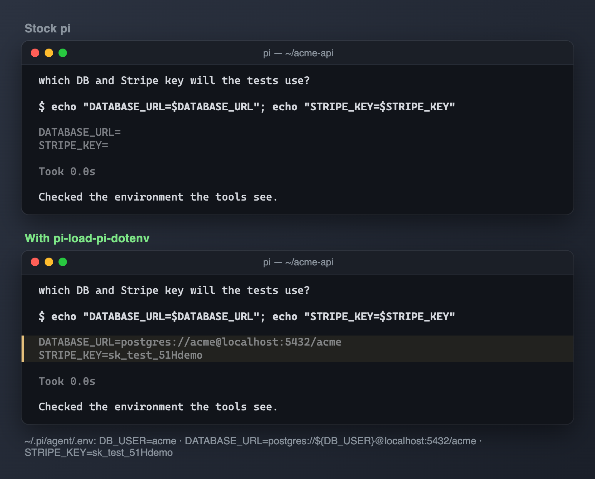

# Pi dotenv loader



*With this extension, variables from `~/.pi/agent/.env`, including `${VAR}` expansion, reach the tools the agent runs. Stock pi passes nothing through.*

Loads environment variables from the Pi agent directory without replacing existing environment values.

## Try locally

From the repository root:

```sh
pi -e ./packages/pi-load-pi-dotenv
```

This uses your normal personal resources unless you isolate the agent home. Follow the [root README](../../README.md#isolated-sessions) to avoid loading an existing copy of the extension. Nothing is installed globally. 

## Configuration and requirements

Reads <agent-dir>/.env, where <agent-dir> is PI_CODING_AGENT_DIR or ~/.pi/agent. Supports $NAME and ${NAME} expansion. Missing and circular references remain literal. Missing files are ignored.

## Compatibility and safety

Loaded values are inherited by subprocesses. Keep .env out of Git. This loader runs during extension initialization; do not assume it loads credentials early enough for every provider's discovery.

Imported host APIs are declared as peer dependencies and supplied by the Pi host. A `*` peer range describes host resolution, not a guarantee of compatibility with every release. See root verification notes for what was actually exercised.

## Status

Part of the [pi-extensions](../../README.md) collection. No personal settings or credentials are included; see [NOTICE.md](NOTICE.md) for licensing and provenance.
