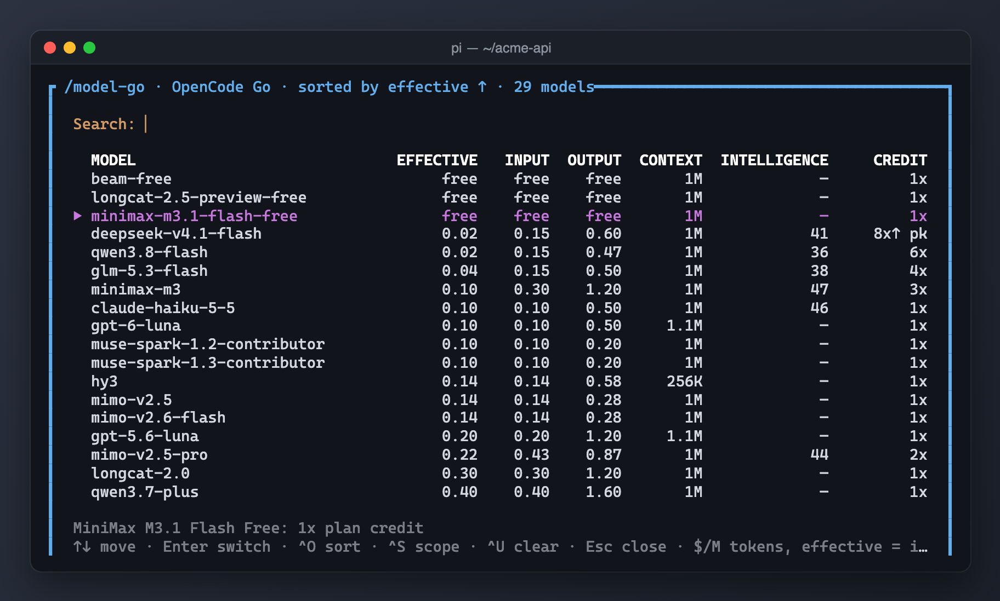

# pi-model-go



*`/model-go` lists OpenCode Go models sorted by effective price (input ÷ plan credit), with context size, intelligence score and credit multiplier.*

Cost-aware model picker showing registry prices/context, OpenCode Go credit multipliers and stencil.so intelligence scores. Source describes it as a port of rizal72/oc-models-pro.

## Running locally

From the monorepo root:

```sh
pi -e ./packages/pi-model-go
```

**Warning:** this extension uses your existing Pi resources and settings unless you load it in an isolated home (see the root README). Do not load two copies of the same extension (for example an older standalone file alongside this package): commands and hooks can duplicate. The package never installs or relocates personal settings.

## Commands and shortcuts

- `/model-go [query]` — opens the picker; Enter switches the selected model.
- Up/Down or PageUp/PageDown to move; Ctrl+O cycles sort; Ctrl+S cycles Go/with-key/all scopes; Ctrl+U clears search.
- Escape clears a nonempty search, then closes; Ctrl+C closes immediately.

## Settings and storage

Uses Pi's model registry and existing credentials (`OPENCODE_API_KEY` or `/login` for OpenCode Go). Caches data in `<agent-dir>/state/model-go/{go-plan,bench}.json`; `<agent-dir>` is `PI_CODING_AGENT_DIR` or `~/.pi/agent`. Go data is cached for one day, benchmark data for six hours; stale data can be used with warnings.

## Privacy and operations

On command, fetches `https://opencode.ai/v2/docs/console/go/` and `https://catalog.stencil.so/models.json` with 20-second request timeouts and writes cache files. These fetches request public data, not conversation content. Picking changes the active model; later prompts may have different cost/provider privacy. No model completion is requested by the picker.

## Compatibility

Node.js >=24 for development checks; run extensions through Pi's TypeScript loader. Host imports are wildcard peers, not bundled runtime copies. Interactive TUI only; other modes are told to use `/model`. Remote HTML/catalog formats and intelligence/price matching may change; figures are estimates, not billing guarantees. No token-per-second metric is supplied. Source helper retains its optional offline/live self-check; no live check is run by tests.

See [NOTICE.md](NOTICE.md) for provenance. Tests use the monorepo's TypeScript dev dependency and VM loader; they do not contact services or write to user-home resources.
