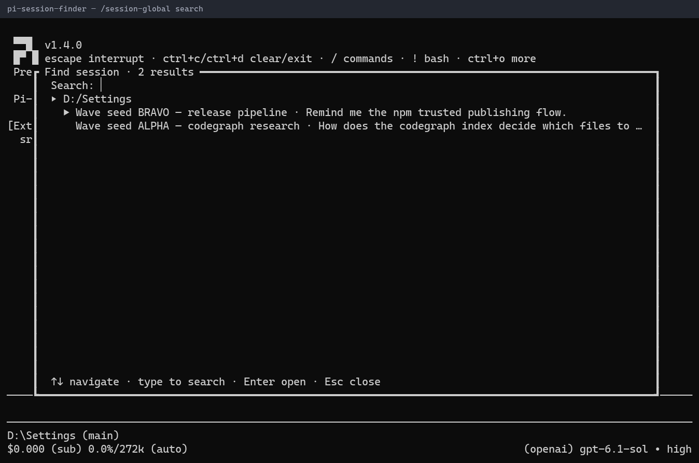

# pi-session-finder



Search saved sessions across projects, display their fork families, and open or fork a conversation into the current project.

## Running locally

From the monorepo root:

```sh
pi -e ./packages/pi-session-finder
```

**Warning:** this extension uses your existing Pi resources and settings unless you load it in an isolated home (see the root README). Do not load two copies of the same extension (for example an older standalone file alongside this package): commands and hooks can duplicate. The package never installs or relocates personal settings.

## Commands and shortcuts

- `/session-global` — opens the searchable session tree.
- `Alt+I` — **preserved source behavior:** inserts `/find` into the editor, not `/session-global`; this package does not register `/find`.
- In the picker: type to search, Up/Down to move, Enter to open, Escape/Ctrl+C to cancel.

## Settings and storage

Scans `PI_CODING_AGENT_SESSION_DIR` or `<agent-dir>/sessions`, plus the current session manager's directory. `<agent-dir>` is `PI_CODING_AGENT_DIR` or `~/.pi/agent`. No package-local configuration.

## Privacy and operations

Reads full JSONL conversations, working directories, names and first user messages across the configured session stores. Same-project choices switch sessions. Cross-project choices ask before creating a new conversation fork; no project files are copied. Cancelled/failed unused forks are removed. No network requests.

## Compatibility

Node.js >=24 for development checks; run extensions through Pi's TypeScript loader. Host imports are wildcard peers, not bundled runtime copies. Interactive custom terminal UI and Pi's `SessionManager.forkFrom`/session-switch APIs are required. The Alt+I `/find` mismatch is intentionally not fixed by packaging.

See [NOTICE.md](NOTICE.md) for provenance. Tests use the monorepo's TypeScript dev dependency and VM loader; they do not contact services or write to user-home resources.
