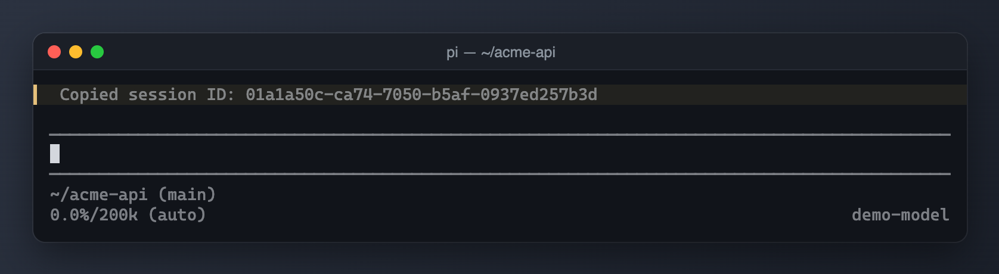

# pi-session-id



*`/session-id` copies the current session ID to the clipboard.*

Copy the current session ID to the system clipboard.

## Running locally

From the monorepo root:

```sh
pi -e ./packages/pi-session-id
```

**Warning:** this extension uses your existing Pi resources and settings unless you load it in an isolated home (see the root README). Do not load two copies of the same extension (for example an older standalone file alongside this package): commands and hooks can duplicate. The package never installs or relocates personal settings.

## Commands and shortcuts

- `/session-id` — copies the current ID; on failure, the notification includes the ID for manual copying.

## Settings and storage

No settings file or persistent state.

## Privacy and operations

Writes the ID to your system clipboard (which may be synchronized by your OS). Clipboard failures are reported; there are no model requests or session-file mutations.

## Compatibility

Node.js >=24 for development checks; run extensions through Pi's TypeScript loader. Host imports are wildcard peers, not bundled runtime copies. Requires Pi's `copyToClipboard` export and working OS clipboard support. Notifications require a UI-capable host.

See [NOTICE.md](NOTICE.md) for provenance. Tests use the monorepo's TypeScript dev dependency and VM loader; they do not contact services or write to user-home resources.
