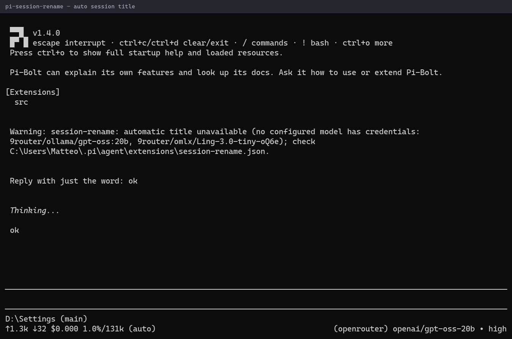

# pi-session-rename



*After the first prompt, the session gets a generated title. It appears in the footer and in the terminal tab title.*

Automatically title main interactive sessions from the first submitted prompt and optionally mirror the name to a Herdr tab. Manual names take precedence; failed generation retries on later prompts.

## Running locally

From the monorepo root:

```sh
pi -e ./packages/pi-session-rename
```

**Warning:** this extension uses your existing Pi resources and settings unless you load it in an isolated home (see the root README). Do not load two copies of the same extension (for example an older standalone file alongside this package): commands and hooks can duplicate. The package never installs or relocates personal settings.

## Commands and shortcuts

No slash commands or shortcuts are registered. Submit a real prompt (including `/skill:name args`) in a main TUI session to trigger generation. Existing generated or manual names suppress further requests.

## Settings and storage

Reads `<agent-dir>/extensions/session-rename.json` on each request, where `<agent-dir>` is `PI_CODING_AGENT_DIR` or `~/.pi/agent`. Expected keys: `model` and optional `fallbackModels`, each entry `{"provider", "id", "thinking"?, "baseUrl"?}` (the pi-blackhole model shape). `thinking` is off/minimal/low/medium/high/xhigh/max, default `low`. An entry with `baseUrl` is called directly over the OpenAI Chat Completions API with the `auth.json` credential for its provider (`key`, else `access`; none means keyless), so providers registered by other extensions (e.g. 9router) work without those extensions loaded; `thinking` is sent as `reasoning_effort` capped at `high`. Other entries go through Pi's model registry. Legacy `"provider/model-id"` strings, `fallbacks`, and a top-level `thinking` default still load.

```json
{
  "model": { "provider": "my-router", "id": "some/model:free", "baseUrl": "https://router.example/v1", "thinking": "low" },
  "fallbackModels": [{ "provider": "openrouter", "id": "openrouter/free", "thinking": "off" }]
}
```
 There is no implicit model default and no personal configuration is bundled. Herdr recovery state stays at `~/.pi/herdr-tab-state.json` even with a custom agent directory. Uses `HERDR_ENV=1` and `HERDR_TAB_ID` for tab mirroring.

## Privacy and operations

Sends up to 4,000 prompt characters and the current generated title to the configured provider using Pi credentials (the `auth.json` entry for `baseUrl` entries); never assistant/tool output. Requests have a 60-second deadline and may incur cost. Writes session name/ownership entries, watches the session file, and may invoke the external `herdr` executable to rename/restore tabs. Recovery state contains original tab labels. Isolation of the agent directory alone does not isolate the fixed Herdr state path; unset Herdr variables when testing.

## Compatibility

Node.js >=24 for development checks; run extensions through Pi's TypeScript loader. Host imports are wildcard peers, not bundled runtime copies. Only main `tui` sessions run; `PI_ORCHESTRATOR_CHILD=1`, `PI_SUBAGENT=1`, and `PI_CHILD=1` disable the factory. Entries without a `baseUrl` require Pi model registry/streaming APIs. Herdr support is optional and requires its CLI. No settings file is moved beside the packaged source.

See [NOTICE.md](NOTICE.md) for provenance. Tests use the monorepo's TypeScript dev dependency and VM loader; they do not contact services or write to user-home resources.
