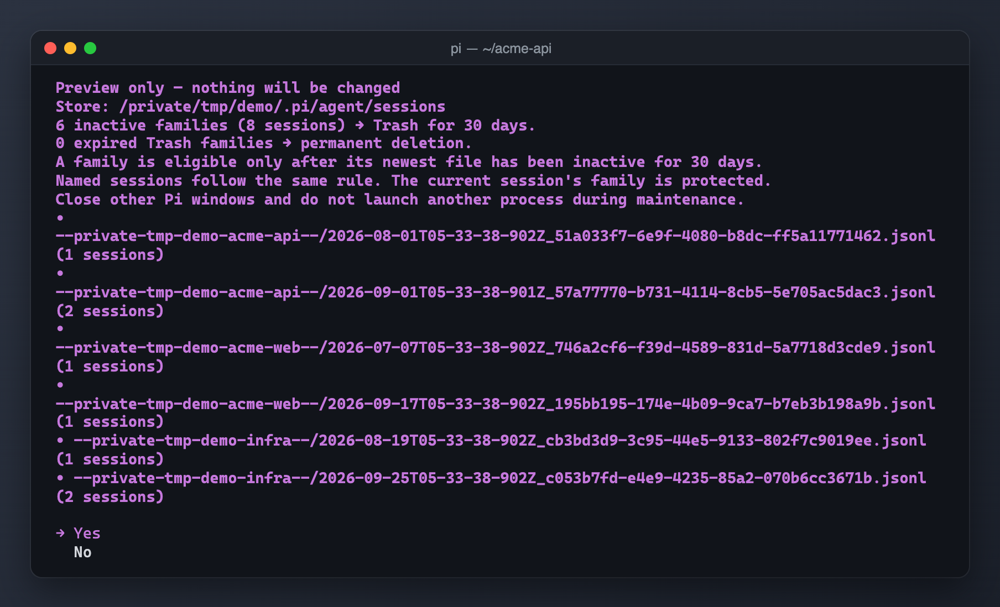

# pi-session-retention



*`/session-cleanup preview` shows which inactive session families would move to Trash. It changes nothing.*

From the monorepo root:

```sh
pi -e ./packages/pi-session-retention
```

**Warning:** this uses existing personal Pi resources and settings unless isolated as described in the root README. Existing retention approval/state is reused: startup may automatically move sessions and permanently purge expired Trash without a new approval. Back up conversations before loading. Do not load two copies of this extension at once.

Node.js >=24 for development; Pi loads the TypeScript extension. Host coding-agent/TUI packages are peers. Store locations and destructive behavior are unchanged. `PI_CODING_AGENT_DIR` selects the agent home (default `~/.pi/agent`); `PI_CODING_AGENT_SESSION_DIR` and explicit session-directory overrides narrow the scope. See the operational notes below and [NOTICE.md](NOTICE.md) for provenance.

## Packaged tests and limitations

Run `node --test packages/pi-session-retention/test/*.test.mjs` from the repository root after its dev dependencies are available. Tests use temporary fixtures or pure helpers, never the real session store. Interactive terminal behavior and OS process discovery still need manual exercise in an isolated agent home. Requires working `ps` on Unix or PowerShell/CIM on Windows and a filesystem supporting exclusive hard-link publication. No network/model requests are made by retention. Trash searches read stored conversation text; local Trash is not encryption or secure erasure.

The original operational README is included under `src/README.md`. Its `bun`-based check commands and deployment statement describe the private workspace this extension was developed in, not this repository; use the repository-root checks above for verification.

## Original operational documentation

# Session retention

Moves inactive session families out of Pi's searchable session store. No search index, scheduler, model calls, or added dependencies.

## Use

- `/session-cleanup preview` — show counts, scope and example candidate families without moving or deleting sessions.
- `/session-cleanup` — review the first cleanup and approve daily automatic maintenance. Later calls run maintenance immediately.
- `/session-cleanup pause` — pause automatic maintenance; run `/session-cleanup` to review and enable it again.
- `/session-trash [query]` — search trashed families by name, first user prompt, ID or original path. ↑↓ selects; Enter previews; Ctrl+R requests a confirmed whole-family restore from either view. In preview, `[ ]` switches members and ↑↓ / PgUp/PgDn scrolls. Esc returns to search or closes it. An optional query prefills the filter.

`/session-cleanup` advertises `[preview|pause]` and offers both arguments through command completion.

The footer shows maintenance phases: scanning, approval, process checks, moving sessions and purging expired Trash. Trash loading and restoration also show status. The status clears on completion, cancellation or failure; it does not leave an idle indicator.

Interactive startup checks at most once per 24 hours, including after session switches/reloads. Print, JSON and RPC modes never run maintenance. There is no OS scheduler: expired Trash remains until the next successful cleanup.

## Rules

A family consists of a session and every descendant linked by `parentSession`, including descendants in another project. Its activity clock is the newest filesystem modification time or header timestamp among its members. Only families strictly more than 30 days inactive qualify. Named sessions use the same rule. The current session protects its entire family.

Trashed families receive another 30 days before permanent deletion. Restoring a family preserves its JSONL contents and original paths, updates file modification times to give the whole family a fresh 30-day grace period, and never overwrites existing files.

Default scope is every project under the agent's normal `sessions` store. A custom session directory reported by the session manager is treated as its own store; the extension does not sweep unrelated custom locations. Trash is a sibling `.trash/<store-name>-<path-hash>` directory **outside** the live store, not `sessions/.trash`. Approval, pause state, daily timestamp and maintenance lock live there too, not in this repository.

Startup reads bounded session headers and file metadata, not every transcript. A cleanup batch revalidates the family graph once, rather than rescanning the entire store for each family. Only explicit Trash searches read conversation text from trashed files. Normal session discovery no longer needs to read those files. This does not erase copies exported elsewhere or memories already retained by external integrations.

## Safety and recovery

- Maintenance protects every verified open session's whole family, including idle windows, while cleaning unrelated inactive families. All open instances must load the updated extension and share an agent home; reload/update or close any instance reported as unregistered. Shared registration and per-store locks serialize maintenance and block session switches/forks until it ends. Unrecognized SDK hosts and renamed executables remain outside process detection; do not run maintenance alongside them.
- On `/reload`, session replacement or graceful shutdown, maintenance cancels pending approval/Trash dialogs, stops at the next safety boundary and waits for in-flight file work to finish before releasing its lock. The lock is never removed while its operation can still mutate files. Forced termination or a crash can still leave a stale lock; these are not automatically removed.
- Each family has a recovery manifest written before any file moves. Incomplete operations remain recoverable in `/session-trash` and are never automatically purged. Keep the manifest with its files. If the process crashes leaving `.maintenance.lock`, close all Pi processes before removing that stale lock and retrying. A corrupt lock fails closed rather than being guessed away.
- Symlink paths, invalid headers, unresolved parents, family cycles, changed files and corrupt/path-escaping manifests are rejected or protected. An unreadable session can defer cleanup because the complete family graph cannot be established safely. Restore collisions do not overwrite either copy.
- Moving session files does not retroactively ingest them into external memory integrations. Such integrations retain their live in-memory state and flush outstanding writes at shutdown; they do not depend on reopening historical JSONL files for those writes. Earlier failed ingestion is not repaired by this extension.

Updated, registered Pi windows may stay open during maintenance. Sampled OS process discovery and extension-owned locks are not native session locks honored by every program: do not launch another Pi process while maintenance runs. Back up irreplaceable conversations before approving retention.

## Development checks

This copy lives in the [pi-extensions](https://github.com/saifymatteo/pi-extensions) repository. Run its checks from the repository root: `node --test packages/pi-session-retention/test/*.test.mjs` (temporary fixtures and pure helpers; the real session store is never touched) and `npm run smoke` for an isolated host load. Interactive terminal behavior and OS process discovery still need manual exercise in an isolated agent home.

Requires working `ps` on Unix or PowerShell/CIM on Windows and a filesystem supporting exclusive hard-link publication. No network or model requests are made by retention. Trash searches read stored conversation text; local Trash is not encryption or secure erasure.
