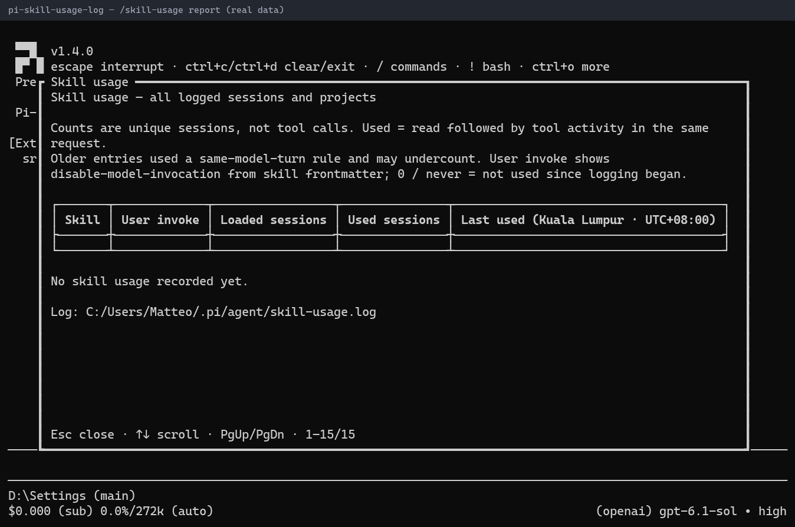

# pi-skill-usage-log



Passively record skill loads and subsequent tool activity, then show cross-project usage without adding the report to conversation context.

## Running locally

From the monorepo root:

```sh
pi -e ./packages/pi-skill-usage-log
```

**Warning:** this extension uses your existing Pi resources and settings unless you load it in an isolated home (see the root README). Do not load two copies of the same extension (for example an older standalone file alongside this package): commands and hooks can duplicate. The package never installs or relocates personal settings.

## Commands and shortcuts

- `/skill-usage` — opens the all-project report (no arguments).
- Up/Down, PageUp/PageDown, Home/End scroll; Escape/Ctrl+C/Enter close.

## Settings and storage

Appends TSV rows to `<agent-dir>/skill-usage.log`; `<agent-dir>` is `PI_CODING_AGENT_DIR` or `~/.pi/agent`. No configuration file. Both legacy six-column and model/thinking eight-column rows are read. Loaded/used events are deduplicated per session.

## Privacy and operations

Log stores timestamps, session IDs, working directories, skill names/paths and selected agent model/thinking level. It is persistent local history with no rotation or removal feature. No prompt text, tool result content or network requests are logged/sent. A successful SKILL.md read followed by another non-think tool call in the same request counts as use; this is a heuristic, not proof. Merely loading this package enables tracking.

## Compatibility

Node.js >=24 for development checks; run extensions through Pi's TypeScript loader. Host imports are wildcard peers, not bundled runtime copies. Reports require interactive terminal mode; tracking uses Pi lifecycle and tool hooks. Installed skill listing depends on `getCommands()` skill metadata. Older historical counts use a narrower same-turn heuristic and cannot be repaired.

See [NOTICE.md](NOTICE.md) for provenance. Tests use the monorepo's TypeScript dev dependency and VM loader; they do not contact services or write to user-home resources.
