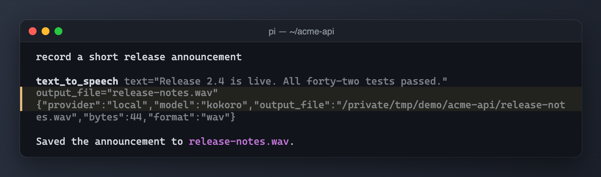

# @saifymatteo/pi-tts



*The agent calls `text_to_speech`, and the WAV file from the configured speech endpoint is saved into the project.*

## Purpose and registrations

Registers `text_to_speech` when the registry has a `type: "tts"` model; no slash commands or playback. Sends narration to a service and saves a new WAV, never overwriting an existing output. Uses standard fetch/streams and Pi tool registration; requires filesystem hard-link support for atomic publication.

## Configuration and service

Reads the shared `<agent-dir>/extensions/service-models.json` registry and uses every model with `type: "tts"` and `api: "openai-audio-speech"`. A missing registry or no TTS model leaves the tool absent; no automatic config creation. A model may set default `voice` and `language` (requests can override them) and an optional one-line `description`, shown to the agent as a strength hint in the `model` parameter. Opt in by manually creating the registry from `examples/service-models.example.json`.

Requires an OpenAI-compatible speech server (POST `audio/speech` relative to the versioned base URL), not an installed CLI. Keys accept `$ENV` / `${ENV}`; omission falls back to agent `auth.json`, explicit `""` permits keyless TTS. Use environment references rather than embedded credentials.

## Security and limits

All narration is transmitted to the selected service. Do not send secrets. 120s timeout, no retries/fallback, redirects rejected, 20000 characters/100 MiB maximum. Requires a new `.wav` path with an existing parent; writes private staging files beside output and hard-links atomically. Parent symlinks are not prohibited by the inherited implementation; only request trusted output paths. Output is local and never played automatically.

## Tests

From the monorepo root with its existing test dependencies available:

```sh
node --test packages/pi-tts/test/*.test.mjs
```

Tests use the shared test-only TypeScript/VM loader, fixtures, and host/service stubs. They do not prove compatibility with a live host, CLI, or model service.

## Running locally

From the monorepo root:

```sh
pi -e ./packages/pi-tts
```

Node >=24; host imports are peers, not bundled dependencies. Load only one copy: for an isolated session use `--no-extensions` with explicit `-e` paths so the original live extension is not also discovered. Set `PI_CODING_AGENT_DIR` to a disposable agent directory before launch; unset means the normal `~/.pi/agent` fallback. Extension config continues to resolve there, never relative to this package.

Examples are manually authored, sanitized reference documents, not runtime defaults. Review and manually create only the needed files in the isolated agent directory; do not copy live credentials or endpoints. No example is automatically loaded or copied. Loading an extension grants Pi-process OS permissions. Licensed AGPL-3.0-only; see [NOTICE.md](NOTICE.md).
