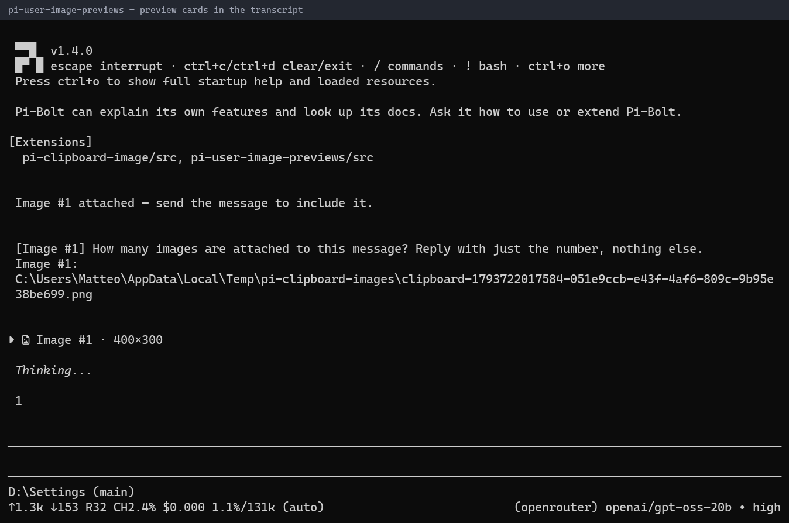

# Inline user image previews



Adds collapsible UI-only previews for newly submitted image attachments.

## Try locally

From the repository root:

```sh
pi -e ./packages/pi-user-image-previews
```

This uses your normal personal resources unless you isolate the agent home. Follow the [root README](../../README.md#isolated-sessions) to avoid loading an existing copy of the extension. Nothing is installed globally. 

## Configuration and requirements

No config files. Ctrl+O expands/collapses previews. References original messages without inserting duplicate model image payloads.

## Compatibility and safety

Source targets Pi 1.3+ and uses host transcript/layout details. Requires an image-capable terminal for graphics. No independent image upload or model request is made by this package.

Imported host APIs are declared as peer dependencies and supplied by the Pi host. A `*` peer range describes host resolution, not a guarantee of compatibility with every release. See root verification notes for what was actually exercised.

## Status

Part of the [pi-extensions](../../README.md) collection. No personal settings or credentials are included; see [NOTICE.md](NOTICE.md) for licensing and provenance.
