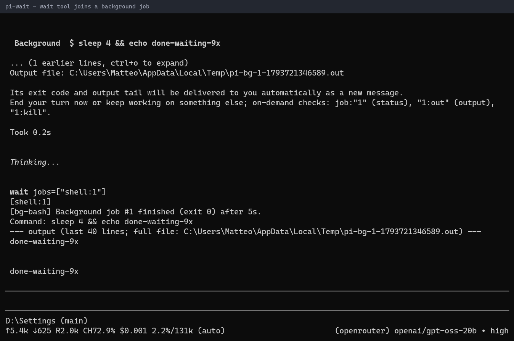

# @saifymatteo/pi-wait



## Purpose and registrations

Registers the `wait` tool, joining 1..64 unique explicit `shell:<id>` / `agent:<id>` jobs. Returns results in requested order. Timeout releases claims without stopping work; abort/session changes invalidate the join. No commands or configuration files; no external CLI/model service.

## Cooperative delivery contract

Synchronous session-scoped `async-work:providers:v1` discovery receives `{sessionFile, add(provider)}`. Providers expose `source` and atomic `claim(ids, owner)` returning `{result, commit, release}`. Wait validates all results and serializes a snapshot before committing; finally it releases all leases. Commit/release must be synchronous, idempotent and nonthrowing. Duplicate providers, already consumed/submitted work and missing providers fail rather than duplicate delivery. See `src/lib/async-work.ts`.

Load `pi-bg-bash` for shell jobs. An orchestrator implementing the same contract is separate and external, not bundled or created by this package; it supplies agent jobs and parent-abort fleet cancellation.

## Host limitations and security

Requires Pi's shared synchronous event bus and session manager; does not join arbitrary OS processes or persist jobs across runtime restarts. No network/filesystem operations of its own. Provider job output becomes model-visible; do not join secret-bearing results. Timeout is 300000ms by default, maximum 1800000ms.

## Tests

From the monorepo root with its existing test dependencies available:

```sh
node --test packages/pi-wait/test/*.test.mjs
```

Tests use the shared test-only TypeScript/VM loader, fixtures, and host/service stubs. They do not prove compatibility with a live host, CLI, or model service.

## Running locally

From the monorepo root:

```sh
pi -e ./packages/pi-wait
```

Node >=24; host imports are peers, not bundled dependencies. Load only one copy: for an isolated session use `--no-extensions` with explicit `-e` paths so the original live extension is not also discovered. Set `PI_CODING_AGENT_DIR` to a disposable agent directory before launch; unset means the normal `~/.pi/agent` fallback. Extension config continues to resolve there, never relative to this package.

Examples are manually authored, sanitized reference documents, not runtime defaults. Review and manually create only the needed files in the isolated agent directory; do not copy live credentials or endpoints. No example is automatically loaded or copied. Loading an extension grants Pi-process OS permissions. Licensed AGPL-3.0-only; see [NOTICE.md](NOTICE.md).
