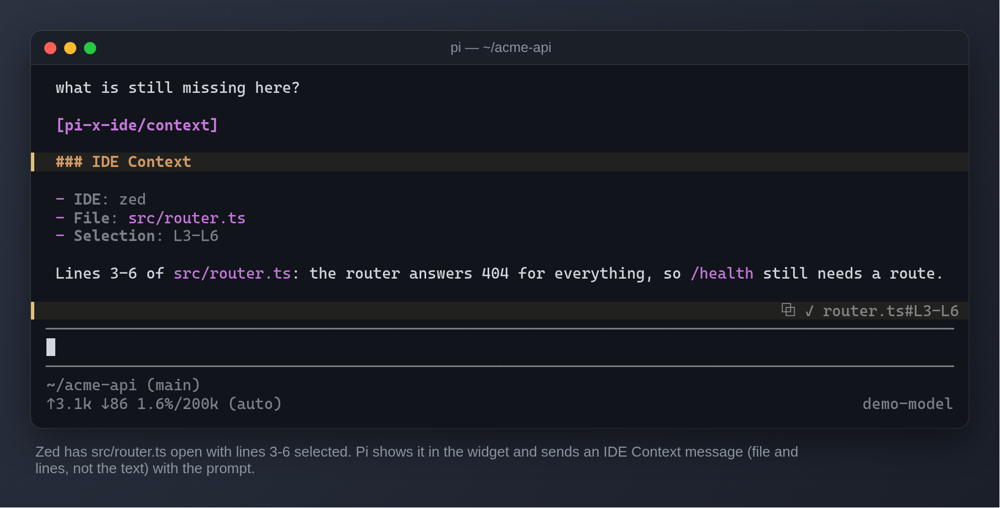

# pi-x-ide



A fork of [balaenis/pi-x-ide](https://github.com/balaenis/pi-x-ide) that gives [Pi](https://pi.dev) the file and selection open in your IDE: VS Code-family editors, JetBrains IDEs, Neovim, and Zed.

**This package is the Pi side only.** The editor plugins (VS Code extension, JetBrains plugin, Neovim plugin) are unchanged upstream releases; install them from upstream as described in the [docs](docs/tutorials/get-started.md). On startup Pi offers to install the upstream VS Code extension (`balaenis.pi-x-ide`) for you. Zed needs no plugin.

## Install

```bash
pi install npm:@saifymatteo/pi-x-ide
```

Published to npm as [`@saifymatteo/pi-x-ide`](https://www.npmjs.com/package/@saifymatteo/pi-x-ide), and bundled in the [`@saifymatteo/pi-extensions`](https://github.com/saifymatteo/pi-extensions) collection; install one or the other. Releases publish from pi-extensions with `pi-x-ide-v<version>` tags.

## Changes in this fork

### IDE context as its own message

When IDE context is attached to a prompt, Pi shows it as a separate **IDE Context** message instead of editing your prompt. It names the IDE, the file, and the selected line range, but not the selected text, so the agent reads the file itself when it needs more:

```text
### IDE Context
- **IDE**: vscode
- **File**: `src/main.ts`
- **Selection**: L10-L20
```

The file path is relative to Pi's working directory when the file is inside it, and absolute otherwise, so it stays correct when the IDE has a parent folder open. The selection line is left out when nothing is selected.

### Zed from any terminal

Upstream follows Zed only when Pi runs in Zed's own terminal. Here Pi attaches from any terminal, once Zed is running and one of its open windows contains Pi's working directory. While no IDE is connected Pi re-checks every 5 seconds, so opening the project in Zed after Pi, or reopening Zed, reconnects without `/ide`. Closing the project's window or quitting Zed disconnects. See [Use Pi × IDE with Zed](docs/how-to/install-zed.md).

## Configuration

`~/.pi/agent/extensions/pi-x-ide.json` (global; `$PI_CODING_AGENT_DIR/extensions/` when set) or `<project>/.pi/extensions/pi-x-ide.json`. An existing `~/.pi/pi-x-ide/config.json` moves to the global path on the next start; otherwise a missing global file is created with every default. Set `"$schema": "https://raw.githubusercontent.com/saifymatteo/pi-extensions/main/packages/pi-x-ide/schemas/pi-x-ide.schema.json"` for editor completion; [`examples/pi-x-ide.example.json`](examples/pi-x-ide.example.json) shows every option. Full reference: [Configuration](docs/reference/configuration.md).

## Documentation

- [Get started](docs/tutorials/get-started.md)
- [Commands](docs/reference/commands.md)
- [Architecture](docs/explanation/architecture.md)
- [Troubleshoot a connection](docs/how-to/troubleshoot-connection.md)

## License

AGPL-3.0-only for changes from 1.22.0 onward; the upstream Apache-2.0 code keeps its license. See [NOTICE.md](NOTICE.md).
